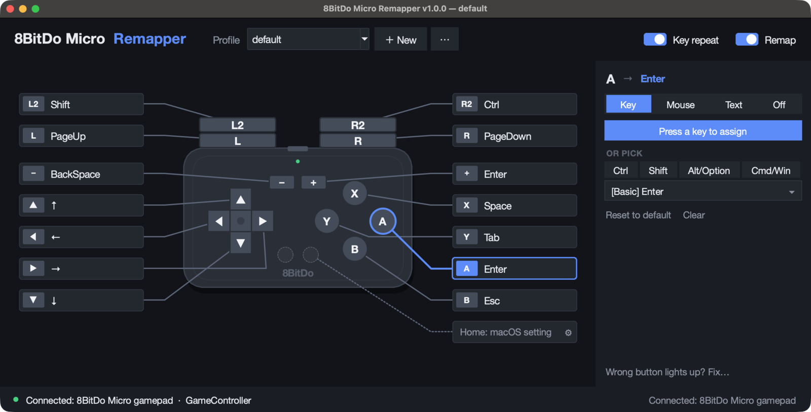

# 8BitDo Micro Remapper



A desktop app that turns the **8BitDo Micro** into a programmable macro pad.
It shows the controller's layout on screen, and you can map each button to a key,
a key combo, a mouse action, or a piece of text. It runs on **macOS and Windows**
and works over **Bluetooth or USB**.

## Features

- Shows the Micro's layout. Each button has a label with its current mapping
  and a line linking the label to the button.
- Assign a key either way:
  - **Press the key**: combos like `Ctrl+C` work too, as does a modifier on its own.
  - **Pick from a list**: modifier toggles plus a searchable key list that
    opens on the key currently set.
- Action types: keyboard key or combo, mouse (click, wheel, cursor movement), typed text, or off.
- Buttons light up when you press them. Holding a button repeats the key.
- Profiles: create, duplicate, import and export them as JSON. Changes are saved automatically.
- Keeps working while other apps are in front.
- On macOS, keys are sent like a real keyboard, so apps that use global hotkeys
  (Carbon `RegisterEventHotKey`) also see them, including F-keys.

## Download

Get the zip for your OS from [Releases](../../releases):

| OS | File |
|---|---|
| macOS (Apple Silicon) | `8BitDo-Micro-Remapper-macOS-arm64.zip` |
| Windows (x64) | `8BitDo-Micro-Remapper-Windows-x64.zip` |

- **macOS**: the app is signed and notarized, so it opens like any other app.
- **Windows**: unzip the file and run `8BitDo Micro Remapper.exe`. SmartScreen may warn
  because the app is unsigned. Choose **More info → Run anyway**.

## Controller setup

1. Set the mode switch on the back of the Micro to **D** (gamepad mode).
   In **K** (keyboard) mode the Micro types keys by itself, so they can't be remapped.
   The app detects K mode and tells you.
2. Connect it over **Bluetooth** (pair it in the OS Bluetooth settings) or with a **USB** cable.

## Usage

1. Click a button, or its label, on the controller picture.
2. In the right-hand panel, choose an action:
   - **Key**: click **Press a key to assign** and then press the key or combo.
     Or choose modifiers and a key from the list.
   - **Mouse**: choose a click, a wheel direction or a cursor movement.
   - **Text**: enter the text the button should type.
   - **Off**: the button does nothing.
3. That's it. Changes take effect immediately and are saved.

The **Remap** switch in the toolbar pauses all mappings.

### Auto power-off

The Micro switches itself off after 15 minutes without a button press, and its firmware
can't be changed. **⏻ Power-off** in the toolbar lets it stay on longer: 30 min, 1, 2, 4, 6
or 8 hours, or **Never**. While the time hasn't run out, the app sends the controller a
harmless signal every 30 seconds, which resets its idle timer. Longer times use more battery.
The default, *15 min*, sends nothing.

### Updates

At launch the app checks GitHub for a newer release and shows a bar when one is available.
**Update now** downloads it, replaces the app and restarts it. You can also use
**⋯ → Check for updates…**, and turn the launch check off in the same menu.

### Closing the window

Closing the window keeps the app running, so your buttons stay remapped. It lives in the
menu bar (macOS) or the notification area (Windows): use that icon to show the window
again or to quit. To quit when the window closes instead, turn off
**⋯ → Keep running when the window is closed**.

### Wrong button lights up?

Click **Wrong button lights up? Fix…** at the bottom of the panel. The app then asks you
to press each button in turn, and re-learns which physical button is which.
Your key assignments are kept.

## macOS notes

- **Accessibility permission is required** to send key presses. Open System Settings → Privacy &
  Security → **Accessibility** and enable the app. If you run from source, enable your terminal
  instead. Then restart the app.
- **Stop the Home button from opening the Games app**: open System Settings → **Game Controllers**
  → Home Button and turn off **Enable Home Button Actions**. You can also click the Home button's
  label in the app and choose *Open Game Controller settings…*.
  - The Home menu also has an *Exclusive mode*, which blocks Home inside the app. Avoid it:
    in that mode the Micro stops sending D-pad input.
- The two small centre buttons can't be remapped. The star button is handled inside the
  controller, and Home doubles as the power button.

## Windows notes

No extra setup is needed. To send keys to an app that runs as administrator,
run this app as administrator too.

## Run from source

Requires Python 3.9+ with tkinter.

```bash
git clone https://github.com/jojonki/8BitDo-Micro-Remapper.git
cd 8BitDo-Micro-Remapper
python3 -m venv .venv
source .venv/bin/activate          # Windows: .venv\Scripts\Activate.ps1
pip install -r requirements.txt
python -m remapper
```

## Settings and profiles

| OS | Location |
|---|---|
| macOS | `~/Library/Application Support/8BitDoMicroRemapper/` |
| Windows | `%APPDATA%\8BitDoMicroRemapper\` |

`profiles/*.json` holds the profiles. `settings.json` holds the app settings and the learned button bindings.

```json
{
  "name": "game",
  "device": "8BitDo Micro",
  "mappings": {
    "a":  {"type": "key", "keys": ["ctrl", "c"]},
    "b":  {"type": "mouse", "button": "right"},
    "x":  {"type": "text", "text": "hello"},
    "l2": {"type": "none"}
  }
}
```

Button IDs: `up down left right a b x y l r l2 r2 minus plus`

## How it works

```
8BitDo Micro ──BT/USB──▶ input process (pygame-ce / SDL2)
                              │ press / release
                              ▼
                         GUI (tkinter) ── profile ──▶ key / mouse output ──▶ OS
                                                      (Quartz on macOS, pynput elsewhere)
```

On macOS, Tk and SDL both want to own the native event loop. The controller is
therefore read in a separate process.

Set `MICRO_REMAPPER_LOG=/path/to/file.log` to log every controller event (useful for debugging).

## Tests

```bash
python -m unittest discover -s tests -v
```

## Building the apps

```bash
pip install pyinstaller
pyinstaller --noconfirm packaging/remapper.spec   # → dist/ (.app on macOS, .exe on Windows)
```

Pushing a tag such as `v1.2.0` runs `.github/workflows/release.yml`, which builds the apps
and creates a draft GitHub Release with the Windows build. The macOS app is signed and
notarized on a Mac with a Developer ID certificate, then attached, and the draft is published:

```bash
xcrun notarytool store-credentials notary --apple-id <Apple ID> --team-id <TEAM ID>   # once
packaging/macos_release.sh --upload
gh release edit v1.2.0 --draft=false
```
